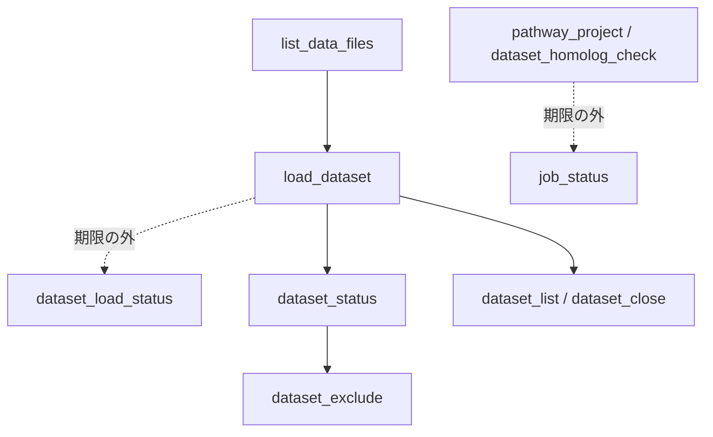

# ワークフロー: データセット投入の入口（読み込み・一覧・閉じる・試料・除外）

ここは**どのファイルのどの関数をどの順に呼ぶか**。出てくる値の**意味**（行の粒度・gap-fill・
SME と SML の区別・`identification_status`・`name_source`・`inchikey_coverage`）は
`docs/output_format/dataset.md`（解析フォルダ）と `docs/output_format/mztab.md`（mzTab-M）。
入口は `list_data_files`（フォルダの中身を確かめる）→ `load_dataset`（解析フォルダも mzTab-M も同じ入口）。
期限（`wait_seconds`）の中で読み終わらなければ、`load_dataset` は受付番号を返し、`dataset_load_status` で結果を引く（こちらも `wait_seconds` で最長 30 秒まで終わりを待てる）。
長い道具（`handle_dispatch.LONG_RUNNING`: `pathway_project` / `dataset_homolog_check`）の受付番号（`job_…`）は `job_status` で引く。
読み込んだデータセットは `dataset_list` / `dataset_close` で管理し、`dataset_status` で試料を確かめ、
`dataset_exclude` で外す。

## list_data_files

前提: なし
状態変更: なし

ツール層（`tools/dataset.py`）は純関数（`path_resolvers.list_data_files`）の結果を拡張子ごとに
まとめて返す。**`directory` は必須**（既定の探索先・環境変数は無い。B-2b）。
**既定は解析できる拡張子だけ**（.arf / .arf2 / .pai2 / .dcl / .EIC.aef / .mddata /
.mdproject と、MS-DIAL を回した形跡の `.mzTab`・`analysis-job.json`）。MS-DIAL の出力フォルダには測定生データ（.wiff 等）が同居し、実データでは
495 ファイル中 7 割以上がそれだった。全部見たいときだけ `all_files=True`。

`all_files=True` と `extension` 明示のときだけ、**フォルダ形式の計測データ**
（Agilent・Bruker の `.d`、Waters の `.raw`）も一覧に含める。フォルダを一律に
除外すると、その形式だけが入った生データフォルダが「空」に見えて入口で誤読される。
どのフォルダが計測データかの判定は `console/job_manager.py` の `is_raw_input()` が
持ち（上流 `AnalysisFilesParser.ReadFolderContents` の `isVendorDirectory` と同じ規則）、
`path_resolvers` はそれを借りる——同じ規則を 2 か所に書くとドリフトするため。

純関数側は見つからなければ**空リスト**を返す。文面（「存在しません」等）を持つのは
ツール層だけで、以前のようにエラー文字列がパスの位置に紛れ込むことはない。

`all_files=True` のときは、一覧の後に **raw の取得時刻**の節を足す（`metabolomix/rawmeta/`。
スペクトルは解さず、ファイルの見出しのメタデータだけを読む: `.wiff` の OLE の時刻・mzML の
`startTimeStamp`・Thermo `.raw` の見出し・Bruker `.d` の `analysis.tdf` / `analysis.sqlite`）。
raw ごとの取得時刻と順（読めないものは順が空で、理由を出す）、40 分を超える間隔の数を返し、
フォルダに `sample-manifest.tsv` があればその群（生体試料の行）と取得順の重なり
（`complete` / `partial` / `independent` / `unknown`）を群の組ごとに返す。

1. metabolomix/tools/dataset.py  list_data_files()
2. └─ metabolomix/core/path_resolvers.py  list_data_files()
3. └─ metabolomix/tools/dataset.py  _acquisition_lines()
4.    └─ metabolomix/rawmeta/acquisition.py  acquisition_order()
5.       └─ metabolomix/rawmeta/acquisition.py  read_acquisition_times()
6.    └─ metabolomix/rawmeta/acquisition.py  gaps_over()
7.    └─ metabolomix/tools/dataset.py  _sheet_groups()
8.    └─ metabolomix/rawmeta/acquisition.py  group_overlap()

## load_dataset

入口は `metabolomix/dataset/opening.py` の `open_dataset()`（対話も再解析も `load_dataset` の 1 本）。
4 つの入口（`directory` / `mztab_path` / `job_path` / `pipeline_path`）のちょうど 1 つを、
`source`（`auto` / `folder` / `mztab`）で決まるアダプタで読む: `directory` は解析フォルダ、
`mztab_path` は mzTab-M、`job_path` / `pipeline_path` は既定で解析フォルダ・`source="mztab"`
で mzTab-M。読み込み済みの基はハンドルの登録簿に覚え（キーは入口・アダプタ・measure・
allow_incomplete・絶対パス）、読み込みが読んだファイルと探したファイル（`_signature()`:
入力・`source_files`・解析フォルダの付随ファイルと `.arf` / `*_Loaded.*.dbs` の一覧・正準
mzTab-M と今の `arf_candidates()`・検出状態を取り込んだ `.arf`・ジョブの記録と実効メソッドと MSP と
終了証跡・`pipeline-run.json`）の size と更新時刻が同じなら読み直さずに複製を返す。
`load_dataset` は戻ってきた DatasetState をハンドルに包み（極性・`.arf2` / `.dcl`・
データセットが覚えたライブラリ）、`session.adopt_handle()` が登録簿に足して**いつも直近にする**
（上限なら `DATASET_HANDLE_LIMIT` で止め、直近は動かさない）。DatasetState は読み込みの
アダプタが `analysis_dir`（記録の置き場所の基準: 解析フォルダは選んだ `.arf` のフォルダ、
mzTab-M は mzTab-M のフォルダ。指紋には入れない）を決める。`pipeline_path` は `polarity` で run の
極性の単位を 1 つ選んでから読む（`session_handoff.resolve_unit()`。単位が 2 つで `polarity` を省くと
`PIPELINE_POLARITY_REQUIRED` で、`load_dataset` はそれを `needs_input`（`field=polarity`・
`retry_tools=["load_dataset"]`）にして返す。ほかの入口で `polarity` を渡すと `PIPELINE_POLARITY_NOT_APPLICABLE`）。

受付: `load_dataset` は引数（`overview`・`library`）を確かめ、`wait_seconds` を 0〜30 秒に丸め（丸めたら
戻り値に `wait_seconds_note`。数でないものは `DATASET_BAD_REQUEST`）、上限の枠を
1 本取ってから（`reserve()`。開いているハンドルと読み込み中の受付の和で数える）、本体 `_load_now()` を
受付（`core/pending_loads.py`）の daemon スレッドで始め、受付そのもの（`PendingLoad`）を最長 `wait_seconds`
（既定 20 秒）待つ。終われば本体の戻り値をそのまま返し、受付は忘れる。終わらなければ受付番号（`ld_…`）を
返し、読み込みは続く（デスクトップアプリの中継が 36〜60 秒ほどで呼び出しを打ち切るため）。ハンドルの登録と直近の
切り替え（`adopt_handle()`）は本体が終わるときに 1 回だけ起きる。受付番号を返した後に別のハンドルが直近に
なっていたら（`session.current_generation` が受け付けたときから進んでいたら）、登録だけして直近にせず、
ライブラリも移さず、戻り値に `current: false` と `note` を足す。枠は登録で消え、失敗なら返す。本体が
どう終わっても受付は誤りの封筒で終わる（`DomainError` は `mztab_error()`、それ以外は `DATASET_LOAD_FAILED`）。
1. metabolomix/tools/handle_tools.py load_dataset()
2. └─ metabolomix/tools/handle_tools.py _argument_error()
3. └─ metabolomix/core/pending_loads.py clamp_wait()
4. └─ metabolomix/core/handles.py HandleRegistry.reserve()（上限なら受け付けない）
5. └─ metabolomix/core/pending_loads.py PendingCalls.submit()（`_load_reserved()` を daemon スレッドで回す。`tool` と入力の名前 `_input_label()` を添える）
6.    └─ metabolomix/core/pending_loads.py PendingCalls._run()
7.       └─ metabolomix/tools/handle_tools.py _load_reserved()（本体。中身は下の入口とアダプタの選び方。終われば枠を返す）
8. └─ metabolomix/core/pending_loads.py PendingLoad.wait()
9. └─ [期限の中で終わったとき] metabolomix/core/pending_loads.py PendingCalls.discard()
10. └─ [期限の中で終わったとき] metabolomix/core/pending_loads.py with_wait_note()
11. └─ [終わらなかったとき] metabolomix/tools/handle_tools.py _CurrentTicket.detach()

入口とアダプタの選び方（本体。受付のスレッドで回る）:
1. metabolomix/tools/handle_tools.py _load_now()
2. └─ metabolomix/core/handles.py HandleRegistry.check_capacity()
3. └─ metabolomix/dataset/opening.py open_dataset()
4.    └─ metabolomix/core/handles.py HandleRegistry.cached_base()
5.    └─ metabolomix/dataset/opening.py _open()
6.       └─ [pipeline_path] metabolomix/pipeline/session_handoff.py resolve_unit()（極性の単位を選ぶ。中身は下の pipeline_path 経路）
7.       └─ [mzTab-M のアダプタ] metabolomix/dataset/opening.py _load()（下の 3 経路）
8.       └─ [directory] metabolomix/dataset/alignment_files.py select_alignment()
9.       └─ [directory] metabolomix/dataset/msdial_adapter.py load_msdial_folder()
10.         └─ metabolomix/dataset/msdial_adapter.py _console_default_classes()（Console の既定の `.mddata` なら群を置かず役割をファイル名から推定）
11.      └─ [directory] metabolomix/dataset/opening.py _fill_formula_theoretical_mz()（mzTab-M と照合しないので、SME rank 1 の理論 m/z を注釈の組成式と付加体から計算。`theoretical_mz_source = formula_adduct`）
12.         └─ metabolomix/analysis/feature_search.py theoretical_mz()
13.      └─ [directory] metabolomix/dataset/opening.py _enclosing_run_unit()（上へ 3 段まで `pipeline-run.json` を探し、解析フォルダがこのフォルダの単位を選ぶ）
14.         └─ metabolomix/pipeline/session_handoff.py resolve_unit()
15.      └─ [run の中の directory] metabolomix/dataset/opening.py _apply_run_rows()（試料を raw の名前か sample_id で結び、run の試料の対応表を当てる）
16.         └─ metabolomix/analysis/sample_manifest.py resolve_metadata()
17.         └─ metabolomix/analysis/sample_manifest.py apply_defaults_and_inputs()
18.      └─ [job_path を解析フォルダで] metabolomix/dataset/opening.py _folder_via_job()
19.         └─ metabolomix/mztab/loading.py job_gate()
20.         └─ metabolomix/mztab/loading.py job_artifact_paths()
21.         └─ metabolomix/dataset/opening.py _matching_arf()
22.            └─ metabolomix/mztab/evidence.py first_matching_arfs()（pipeline の validate_outputs と共有する選び方）
23.               └─ metabolomix/mztab/evidence.py arf_candidates()
24.            └─ metabolomix/mztab/loading.py read_mztab()
25.            └─ metabolomix/mztab/evidence.py join_axes()
26.            └─ metabolomix/mztab/evidence.py matching_arfs()
27.               └─ metabolomix/mztab/evidence.py scan_arf()（最初に通った候補の ArfScan を返す）
28.            └─ [pipeline で候補が合わないとき、単位の解析フォルダのバッチを新しい順に] metabolomix/dataset/alignment_files.py arf2_batches_newest_first()
29.         └─ metabolomix/dataset/alignment_files.py select_alignment()
30.         └─ metabolomix/dataset/msdial_adapter.py load_msdial_folder()（照合に読んだ ArfScan を使い、`.arf` を読み直さない）
31.         └─ metabolomix/dataset/opening.py _fill_theoretical_mz()（照合した mzTab-M の SME rank 1 の理論 m/z を同じスポット ID に写す。`theoretical_mz_source = mztab`）
32.      └─ [pipeline_path を解析フォルダで] metabolomix/dataset/opening.py _folder_via_run()
33.         └─ metabolomix/dataset/opening.py _folder_via_job()（単位のジョブで。照合の候補に単位の解析フォルダ `analysis_dir` を渡す）
34.         └─ [単位が試料の対応表を持つとき] metabolomix/analysis/sample_manifest.py resolve_metadata()
35.         └─ [単位が試料の対応表を持つとき] metabolomix/analysis/sample_manifest.py apply_defaults_and_inputs()
36.      └─ [directory] metabolomix/dataset/library_memory.py remember_from_folder()
37.      └─ [run の中の directory] metabolomix/dataset/library_memory.py remember_from_run()（known / lbm_only ならこちら）
38.      └─ [job_path] metabolomix/dataset/library_memory.py remember_from_job()
39.      └─ [pipeline_path] metabolomix/dataset/library_memory.py remember_from_run()（選んだ極性の単位の入力から）
40.      └─ [mztab_path] metabolomix/dataset/library_memory.py unknown_record()
41.   └─ metabolomix/dataset/opening.py _signature()
42.   └─ metabolomix/core/handles.py HandleRegistry.put_base()
43. └─ metabolomix/mztab/polarity.py dataset_polarity()
44. └─ metabolomix/tools/handle_tools.py alignment_files_for()
45. └─ metabolomix/tools/handle_tools.py _recall_assay_kind()（解析フォルダの目的ファイルの `assay_kind` をハンドルへ読み戻す）
46.   └─ metabolomix/core/mcp_core.py _report_dir_candidates()
47.   └─ metabolomix/tools/objective.py recall_assay_kind()
48. └─ metabolomix/tools/handle_tools.py _open_library_for()
49. └─ metabolomix/core/session_state.py AnalysisSession.adopt_handle()（直近にする。受け付けた読み込みは `_CurrentTicket.may_become_current()` に従う。直近のハンドルが無いうちに記録したセッションの種別は `_SessionKindCarry` がこのハンドルへ移す）
50.    └─ metabolomix/core/handles.py HandleRegistry.add()
51. └─ metabolomix/tools/mztab_tools.py load_summary_lines()
52.    └─ [解析フォルダ] metabolomix/tools/mztab_tools.py _folder_summary_text()
53.    └─ [mzTab-M] metabolomix/tools/mztab_tools.py _summary_text()
54. └─ metabolomix/tools/mztab_tools.py sample_group_role_counts()
55. └─ metabolomix/dataset/library_memory.py public_view()
56. └─ metabolomix/core/session_state.py AnalysisSession.take_caveat()（意味論の要約。このハンドルの種別で、未読・種別ごとに 1 回だけ。戻り値の最上位 `caveat`）
57. └─ [overview=True] metabolomix/tools/handle_tools.py _first_overview()（既定は計算しない。`dataset_overview` と同じ組み立て）

job / pipeline を解析フォルダで読むときも、ジョブの門（`job_gate()`: ジョブの記録・完了・
正準 mzTab-M の一意な選択と実在・出所の裏取り）は mzTab-M で読むときと同じものを通り、
`exploratory_only`・`source_verification`・`job_path` を同じ規則で書く。`.arf` は正準
mzTab-M の evidence と同じ候補（`arf_candidates()`。pipeline はどれも合わなければ単位の解析フォルダ
`<極性>/input/` のバッチを新しい順に 1 本ずつ。`first_matching_arfs()`）のうち、mzTab-M のアダプタが検出状態を
取り込むときと同じ検証（`matching_arfs()` → `scan_arf()` → `scan_evidence()`。`build_evidence()` と
判定を共有する。特徴数・m/z・試料名）を通ったちょうど 1 本。照合に読んだ `.arf`（`ArfScan`）は
そのまま `load_msdial_folder()` に渡し、同じ `.arf` を 2 度読まない。通るものが無ければ `ALIGNMENT_NOT_FOUND`、
2 本以上なら `ALIGNMENT_AMBIGUOUS`（どちらも候補のファイル名を `details.candidates` に載せ、
`source="mztab"` を案内し、mzTab-M へ黙って切り替えない。`ALIGNMENT_AMBIGUOUS` は、完了した
ジョブでだけ「ジョブの検査を通らない」注意つきで `directory` も案内する）。ジョブの mzTab-M が
壊れていれば code はそのまま（`MZTAB_STRUCTURE_INVALID`）で、`directory` で開く道を案内する。ジョブが記録した付随
アーティファクト（`job_artifact_paths()`）は mzTab-M のアダプタと同じく `artifact_paths` に載せる。
pipeline の run を解析フォルダで読むときに run から引き継ぐのは試料の対応表だけ（v3 の run は受領
`results/receipt.json` の `units.<極性>.samples.rows`、旧 v1 の run は記録の `inputs.manifest`）。
受領が無い・照合できない v3 の run は run の記録の単位から解析フォルダを引き、試料の対応表は載らない
（注記が出る）。検証を通っていない単位（`validated` でない）は `PIPELINE_UNIT_NOT_VALIDATED` で止め、
`allow_incomplete=True` なら探索用に読む。旧 v1 の run が計算した差次的結果はどちらの経路でも載せない
（注記が出る。比較は `dataset_compare` でやり直す）。

mztab_path 経路（直接指定）:
1. metabolomix/dataset/opening.py _load()
2. └─ metabolomix/mztab/loading.py load_dataset_state()
3.    └─ metabolomix/mztab/loading.py read_mztab()
4.       └─ metabolomix/mztab/reader.py parse_mztab()
5.       └─ metabolomix/mztab/validator.py validate_mztab()
6.       └─ metabolomix/mztab/dataset_state.py build_dataset_state()
7.          └─ metabolomix/mztab/validator.py detect_quantification_measure()
8.          └─ metabolomix/mztab/reader.py extract_abundance_matrix()
9.          └─ metabolomix/mztab/dataset_state.py _index_sme_rows()
10.         └─ metabolomix/mztab/dataset_state.py _best_evidence()
11.         └─ metabolomix/mztab/dataset_state.py _resolve_inchikey()（MSP 表なし。中で derive_inchikey）
12.         └─ metabolomix/mztab/dataset_state.py _build_feature_annotations()
13.            └─ metabolomix/mztab/dataset_state.py _resolve_inchikey()
14.         └─ metabolomix/mztab/dataset_state.py _resolve_sample_names()
15.   └─ metabolomix/mztab/evidence.py attach_to_dataset()
16.      └─ metabolomix/mztab/evidence.py join_axes()
17.      └─ metabolomix/mztab/evidence.py arf_candidates()
18.      └─ metabolomix/mztab/evidence.py load_arf_evidence()
19.         └─ metabolomix/mztab/evidence.py scan_arf()（`.arf` を 1 回、metabolomix/arf/reader.py iter_groups() でストリーミングに読む）
20.         └─ metabolomix/mztab/evidence.py scan_evidence()
21.         └─ metabolomix/mztab/evidence.py _join()（build_evidence() と共有の判定）
22.      └─ metabolomix/mztab/evidence.py apply_evidence()

job_path 経路（`source="mztab"`。analysis-job.json の宣言 polarity + measure で正準を選ぶ）:
1. metabolomix/dataset/opening.py _load()
2. └─ metabolomix/mztab/loading.py load_dataset_state()
3.    └─ metabolomix/mztab/loading.py job_gate()
4.       └─ metabolomix/handoff/schema.py AnalysisJob.load()
5.       └─ metabolomix/mztab/loading.py select_primary_entry()
6.       └─ metabolomix/mztab/loading.py _verify_source()
7.    └─ metabolomix/mztab/reader.py parse_mztab()
8.    └─ metabolomix/mztab/validator.py validate_mztab()
9.    └─ metabolomix/mztab/loading.py _msp_table_for_job()
10.      └─ metabolomix/console/method_file.py read_method_keys()
11.      └─ metabolomix/mztab/msp_inchikey.py load_msp_inchikey_table()
12.   └─ metabolomix/mztab/validator.py detect_quantification_measure()
13.   └─ metabolomix/mztab/dataset_state.py build_dataset_state()
14.      └─ metabolomix/mztab/reader.py extract_abundance_matrix()
15.      └─ metabolomix/mztab/dataset_state.py _index_sme_rows()
16.      └─ metabolomix/mztab/dataset_state.py _best_evidence()
17.      └─ metabolomix/mztab/dataset_state.py _resolve_inchikey()
18.         └─ metabolomix/mztab/msp_inchikey.py lookup()
19.         └─ metabolomix/mztab/identity.py derive_inchikey()
20.      └─ metabolomix/mztab/dataset_state.py _build_feature_annotations()
21.         └─ metabolomix/mztab/dataset_state.py _resolve_inchikey()
22.      └─ metabolomix/mztab/dataset_state.py _resolve_sample_names()
23.   └─ metabolomix/mztab/loading.py job_artifact_paths()
24. └─ metabolomix/mztab/evidence.py attach_to_dataset()

pipeline_path 経路（`source="mztab"`。選んだ極性の単位のジョブの正準 mzTab-M を読む）:
1. metabolomix/dataset/opening.py _load()
2. └─ metabolomix/pipeline/session_handoff.py load_run_dataset()
3.    └─ metabolomix/pipeline/session_handoff.py resolve_unit()
4.       └─ metabolomix/pipeline/recovery.py normalize_pipeline_root()
5.       └─ metabolomix/pipeline/store.py load_run()
6.       └─ [v3 の run] metabolomix/pipeline/receipt.py read_receipt()
7.       └─ [旧 v1 の run] metabolomix/pipeline/session_handoff.py run_manifest_rows()
8.    └─ metabolomix/mztab/loading.py load_dataset_state()

dataset と試料の対応表を**同じ run の同じ単位から**載せる。
別の run の試料対応表を混ぜられると、群の対応が黙ってずれた統計が出るため。
`resolve_unit()` は `pipeline-run.json` の版で分かれる: v3 の run は受領（`read_receipt()`。登録した hash と
照合してから読む）の単位から解析フォルダ・ジョブ・試料の対応表を引き、旧 v1 の run（`store.is_legacy()`。読むだけの
記録）は 1 単位として、`resolve_metadata` が `record["inputs"]["manifest"]` に書いた行（`run_manifest_rows()`）を引く。
run が計算した差次的結果は戻さない（比較は `dataset_preprocess` → `dataset_compare` でやり直す）。

読み込みは「読めたか」だけでなく「どれだけ信用してよいか」も返す。
`source_verification` は終了証跡（exit code・identity）とファイル hash が揃って初めて
`verified` になり、ジョブ経由でも証跡が無ければ `legacy_unverified`、直接読みは
`direct_unverified`。**`status == "completed"` という文字列は根拠にしない**——旧経路の
completed は「実行後にファイルが増えた」以上の意味を持たなかった。

完了していない実行（partial / failed / running）の出力は既定で読まない
（`INCOMPLETE_ANALYSIS_JOB`）。`allow_incomplete=True` で読んだ場合は
`exploratory_only=True`（理由は `exploratory_reason`。`JobGate.exploratory_reason`）になる。`pipeline_path` で
検証を通っていない単位を開いたときも、ジョブの status によらず同じ印を付ける（`opening._mark_unvalidated_unit`。
`store.unit_status` が `validated` でない）。比較も書き出しも断らないが、欠けた検体は mzTab 上「その群に無い」ように
しか見えないので、差次的 TSV のメタ行（`# exploratory = true` と理由）・根拠バンドルの manifest（`exploratory`）・
図の但し書きに印を載せる。

`select_primary_entry()` は候補が一意に決まらなければ読まずに停止する
（`QUANTIFICATION_CONFLICT` / `POLARITY_MISMATCH` / `AMBIGUOUS_PRIMARY_MZTAB`）。
どのファイルを読むかは解析結果そのものを変えるため、辞書順にも LLM にも決めさせない。

job_path 経路では手順 24（`attach_to_dataset`）が `artifact_paths` を入れ終えた
**後**に来る。handoff が
記録した `peak_matrix_source` を `.arf` 候補の先頭に使えるのはその時点以降だけ。

### evidence sidecar（検出状態）の取り込み

mzTab-M の `abundance_assay[N]` は非ゼロでも実測ピークか gap-fill 補間かを区別しない。
実データ（60 サンプル × 714 特徴）では**セルの 70.0% が gap-fill** だったので、
非ゼロを検出と数えると検出率を 3 倍以上に過大評価する。隣接する `.arf` は
(スポット × サンプル) の粒度で `MasterPeakID < 0` = gap-fill を持つので、そこから補う。

接合は**名前ではなく数値で検証する**。`.arf` のスポット順が mzTab の `SMF_ID` と
一致することを、スポット数の一致と全特徴の m/z 差（既定 0.01 Da 以内）で確かめる。
実データでは位置一致で最大 6.7 mDa、1 つずらすと 87 Da に爆発するので偶然は起きない。
確認できなければ取り込まず、`feature_qc` に理由を残して warning を出す
——誤接合は検出/未検出を特徴間で入れ替えたまま静かに嘘をつくため。

結果は `ds.detected_mask`（(特徴 × サンプル) の bool 行列）と `ds.feature_qc`（要約）、試料ごとのピークの
RT `ds.per_sample_rt`（`_join()` が `.arf` の列を mzTab-M の試料の順に並べ替える。`dataset_sample_peaks` の材料）。
TSV は書かない（消費者のいない `feature-qc.tsv` を 2026-09-03 に廃止した経緯）。

## dataset_status

`view` で 4 通り。`summary`（既定）は概要に群・役割・タグ・除外の件数とハンドルの `assay_kind` を足し、
`samples` は試料の TSV（`query` は因子トークン。旧 `dataset_status(view="samples")` の `specs` と同じ文法で、
`metabolomix/msdial/sample_factors.py` が照合する）、`tags` はタグごとの特徴 ID、`results` は
ハンドルの統計の行列（`ds.stat_matrices`）と結果（`ds.results`）の一覧。

`summary`:
1. metabolomix/tools/mztab_tools.py dataset_status()
2. └─ metabolomix/tools/mztab_tools.py _samples_tsv()（役割は試料の表から）
3.    └─ metabolomix/tools/mztab_tools.py _metadata_rows()
4. └─ metabolomix/tools/mztab_tools.py _detection_summary()
5. └─ metabolomix/tools/mztab_tools.py sample_group_role_counts()
6.    └─ metabolomix/tools/mztab_tools.py _metadata_rows()
7. └─ metabolomix/tools/mztab_tools.py _tag_counts()

`samples`:
1. metabolomix/tools/mztab_tools.py dataset_status()
2. └─ metabolomix/tools/mztab_tools.py _samples_view()
3.    └─ metabolomix/tools/mztab_tools.py _metadata_rows()
4.    └─ metabolomix/msdial/sample_factors.py build_sample_facets()
5.    └─ metabolomix/msdial/sample_factors.py expand_sample_specs()
6.    └─ metabolomix/msdial/sample_factors.py token_vocabulary()

`tags`:
1. metabolomix/tools/mztab_tools.py dataset_status()
2. └─ metabolomix/tools/mztab_tools.py _tags_view()

`results`（`current` は登録のときのデータの指紋と `metadata_revision` が今と同じか）:
1. metabolomix/tools/mztab_tools.py dataset_status()
2. └─ metabolomix/tools/mztab_tools.py _results_view()
3.    └─ metabolomix/analysis/result_state.py dataset_fingerprint()
4.    └─ metabolomix/tools/mztab_tools.py _matrix_recipe()
5.    └─ metabolomix/analysis/result_state.py is_stats_current()
6.    └─ metabolomix/analysis/stats_results.py contrast_ids()

## dataset_exclude

試料・特徴を解析から外す（可逆）。状態は `DatasetState.excluded_samples` /
`excluded_features`（名前・特徴 ID -> 理由）。入力の指紋には入れず、変わったときだけ
`metadata_revision` を進めて前処理済み行列から先の結果を古くする（`apply_metadata` と同じ
`invalidate_results` の経路）。除外を当てるのは前処理（統計エンジンの `dataset_preprocess` が `study_inputs` で入力へ写す）。
同じ経路で統計エンジンの行列（`ds.stat_matrices`）も
空にする（除外の前の行列 ID は使えなくなる）。

1. metabolomix/tools/sample_tools.py dataset_exclude()
2. └─ metabolomix/analysis/dataset_exclusions.py apply_exclusions()
3.    └─ metabolomix/analysis/dataset_exclusions.py _resolve_samples()
4.    └─ metabolomix/analysis/dataset_exclusions.py _resolve_features()
5.    └─ metabolomix/analysis/result_state.py invalidate_results()

除外の適用（統計エンジンの `dataset_preprocess` の中。`stats_results.study_inputs` が `ds.excluded_*` を `from_dataset` の入力へ写す）:
1. metabolomix/tools/stats_tools.py dataset_preprocess()
2. └─ metabolomix/analysis/stats_results.py study_inputs()
3. └─ metabolomix/analysis/stats/data.py from_dataset()

## dataset_load_status

前提: `load_dataset` が受付番号（`ld_…`）を返していること（知らない番号は `DATASET_LOAD_NOT_FOUND`）。
`load_id` を省くと、まだ結果を渡していない受付（`PendingCalls.unclaimed()`）から選ぶ: ちょうど 1 本ならそれ、
2 本以上なら `needs_input`（`field=load_id`・受付の一覧が選択肢・`retry_tools=["dataset_load_status"]`）、
無ければ `missing_state("load", ["load_dataset"])`。
状態変更: なし（ハンドルの登録と直近の切り替えは、読み込みが終わったときに受付のスレッドが済ませている）。
終わった戻り値を渡した受付には印を付け（`PendingCalls.claim()`）、省いた呼び出しの候補から外す。
読み込み中は `{"status": "loading", "load_id", "elapsed_s"}`、終われば `load_dataset` の戻り値そのもの。
終わった受付は終わってから 1 時間覚え（番号を渡せば同じ文字列を返す）、64 件を超えると終わったものを終わった順に
古いものから捨てる。読み込み中のものは捨てず、64 件すべてが読み込み中なら `load_dataset` が
`DATASET_LOAD_LIMIT` で受け付けない。
`wait_seconds`（既定 0。`clamp_wait()` が 0〜30 秒に丸め、丸めたら `wait_seconds_note`。数でないものは
`DATASET_BAD_REQUEST`）が 0 より大きければ、受付そのものを最長その秒数だけ待ち、その中で終われば戻り値を
そのまま返す。終わらなければ待たないときと同じく今の状態を返す。待っても状態は変わらない。

1. metabolomix/tools/handle_tools.py  dataset_load_status()
2. └─ metabolomix/tools/handle_tools.py  _pick_pending()
3.    └─ [load_id を省いたとき] metabolomix/core/pending_loads.py  PendingCalls.unclaimed()
4. └─ metabolomix/tools/handle_tools.py  _poll()
5.    └─ metabolomix/core/pending_loads.py  clamp_wait()
6.    ├─ [wait_seconds > 0] metabolomix/core/pending_loads.py  PendingCalls.wait()
7.    │  ├─ metabolomix/core/pending_loads.py  PendingCalls._lookup()
8.    │  └─ metabolomix/core/pending_loads.py  PendingLoad.wait()
9.    └─ metabolomix/core/pending_loads.py  PendingCalls.snapshot()
10.      ├─ metabolomix/core/pending_loads.py  PendingCalls._prune()
11.      └─ metabolomix/core/pending_loads.py  PendingCalls._lookup()
12.   └─ [終わっていたとき] metabolomix/core/pending_loads.py  PendingCalls.claim()

## job_status

長い道具（`handle_dispatch.LONG_RUNNING`: `pathway_project` / `dataset_homolog_check`。どれも `wait_seconds`、
既定 20 秒を持つ）は、`install()` が `_wrap_job()` で包む。呼び出しは受付（`pending_loads.jobs`、`PendingJobs`）の
daemon スレッドで始まり、ハンドルのロックと固定はそのスレッドが取って仕事が終わるまで持つ（`_job_call()`:
`dataset_handle` を渡せば `_call_locked()`、省けば受け付けたときの直近のハンドルで `_call_pinned()`）。
`wait_seconds` の中で終われば戻り値をそのまま返し（受付は忘れる）、終わらなければ
`{"status": "running", "job_id": "job_…", "tool", "next"}` を返して仕事は続く。
前提: その受付番号を道具が返していること（知らない番号は `JOB_NOT_FOUND`。`job_id` を省いたときの選び方は
`dataset_load_status` と同じで、無ければ `missing_state("job", ["pathway_project", "dataset_homolog_check"])`）。
状態変更: なし（仕事は受付のスレッドで終わる）。走っている間は `{"status": "running", "job_id", "tool", "elapsed_s"}`、
終われば道具の戻り値そのもの。仕事が例外で終われば `JOB_FAILED` の封筒。

受付（長い道具の呼び出し）:
1. metabolomix/core/handle_dispatch.py  _wrap_job()
2. └─ metabolomix/core/pending_loads.py  clamp_wait()
3. └─ metabolomix/core/handle_dispatch.py  _job_call()
4. └─ metabolomix/core/pending_loads.py  PendingCalls.submit()
5. └─ metabolomix/core/pending_loads.py  PendingLoad.wait()

引く:
1. metabolomix/tools/handle_tools.py  job_status()
2. └─ metabolomix/tools/handle_tools.py  _pick_pending()
3. └─ metabolomix/core/pending_loads.py  PendingCalls.tool_of()
4. └─ metabolomix/tools/handle_tools.py  _poll()

## dataset_list

前提: なし。状態変更: なし。`current` は `session.current_handle_id` と同じハンドルか。`assay_kind` は
そのハンドルのデータセットの種別（`DatasetHandle.assay_kind`）。

1. metabolomix/tools/handle_tools.py  dataset_list()
2. └─ metabolomix/core/handles.py  HandleRegistry.list()

## dataset_close

前提: そのハンドルが開いていること（無ければ `DATASET_HANDLE_NOT_FOUND`）。
状態変更: 登録簿から外し、ライブラリの接続を閉じる（そのハンドルのライブラリは、ハンドルと一緒に
無くなる。対話のセッションの `session.library` が直近のハンドルのライブラリなら、これも無くなる）。直近のハンドルなら、対話のセッションは
データセットが無い状態になる（次に `session.dataset` を読んだときに `current_handle_id` を
None に戻す。別のハンドルへは落ちない）。

戻り値の `source`（入口の種類・入力の名前・極性）は閉じる前に `HandleRegistry.peek()` で読む。

1. metabolomix/tools/handle_tools.py  dataset_close()
2. └─ metabolomix/core/handles.py  HandleRegistry.peek()
3. └─ metabolomix/core/handles.py  HandleRegistry.close()
4.    └─ metabolomix/core/handles.py  DatasetHandle.close()
