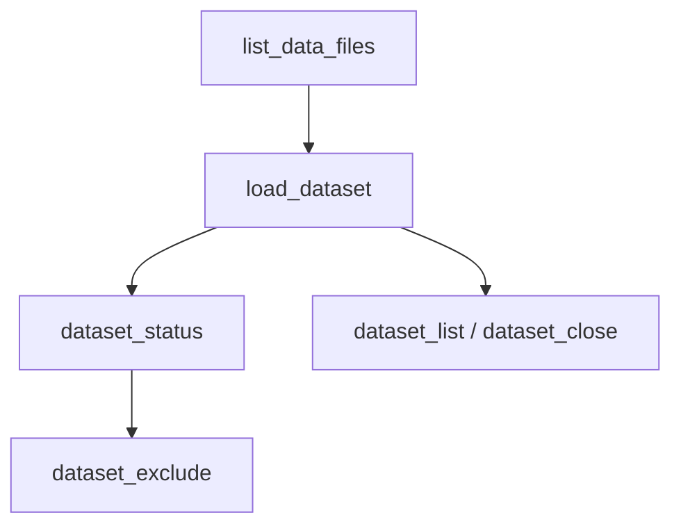

# ワークフロー: データセット投入の入口（読み込み・一覧・閉じる・試料・除外）

ここは**どのファイルのどの関数をどの順に呼ぶか**。出てくる値の**意味**（行の粒度・gap-fill・
SME と SML の区別・`identification_status`・`name_source`・`inchikey_coverage`）は
`docs/output_format/dataset.md`（解析フォルダ）と `docs/output_format/mztab.md`（mzTab-M）。
入口は `list_data_files`（フォルダの中身を確かめる）→ `load_dataset`（解析フォルダも mzTab-M も同じ入口）。
読み込んだデータセットは `dataset_list` / `dataset_close` で管理し、`dataset_status` で試料を確かめ、
`dataset_exclude` で外す。

## list_data_files

前提: なし
状態変更: なし

ツール層（`tools/dataset.py`）は純関数（`path_resolvers.list_data_files`）の結果を拡張子ごとに
まとめて返す。**`directory` は必須**（既定の探索先・環境変数は無い。B-2b）。
**既定は解析できる拡張子だけ**（.arf / .arf2 / .pai2 / .dcl / .EIC.aef / .mddata /
.mdproject と、MS-DIAL を回した形跡の `.mzTab`・`analysis-job.json`）。MS-DIAL の出力フォルダには測定生データ（.wiff 等）が同居し、実データでは
495 ファイル中 7 割以上がそれだった。全部見たいときだけ `all_files=True`。

`all_files=True` と `extension` 明示のときだけ、**フォルダ形式の計測データ**
（Agilent・Bruker の `.d`、Waters の `.raw`）も一覧に含める。フォルダを一律に
除外すると、その形式だけが入った生データフォルダが「空」に見えて入口で誤読される。
どのフォルダが計測データかの判定は `console/job_manager.py` の `is_raw_input()` が
持ち（上流 `AnalysisFilesParser.ReadFolderContents` の `isVendorDirectory` と同じ規則）、
`path_resolvers` はそれを借りる——同じ規則を 2 か所に書くとドリフトするため。

純関数側は見つからなければ**空リスト**を返す。文面（「存在しません」等）を持つのは
ツール層だけで、以前のようにエラー文字列がパスの位置に紛れ込むことはない。

1. metabolomix/tools/dataset.py  list_data_files()
2. └─ metabolomix/core/path_resolvers.py  list_data_files()

## load_dataset

入口は `metabolomix/dataset/opening.py` の `open_dataset()`（対話も再解析も `load_dataset` の 1 本）。
4 つの入口（`directory` / `mztab_path` / `job_path` / `pipeline_path`）のちょうど 1 つを、
`source`（`auto` / `folder` / `mztab`）で決まるアダプタで読む: `directory` は解析フォルダ、
`mztab_path` は mzTab-M、`job_path` / `pipeline_path` は既定で解析フォルダ・`source="mztab"`
で mzTab-M。読み込み済みの基はハンドルの登録簿に覚え（キーは入口・アダプタ・measure・
allow_incomplete・絶対パス）、読み込みが読んだファイルと探したファイル（`_signature()`:
入力・`source_files`・解析フォルダの付随ファイルと `.arf` / `*_Loaded.*.dbs` の一覧・正準
mzTab-M と今の `arf_candidates()`・検出状態を取り込んだ `.arf`・ジョブの記録と実効メソッドと MSP と
終了証跡・`pipeline-run.json`）の size と更新時刻が同じなら読み直さずに複製を返す。
`load_dataset` は戻ってきた DatasetState をハンドルに包み（極性・`.arf2` / `.dcl`・
データセットが覚えたライブラリ）、`session.adopt_handle()` が登録簿に足して**いつも直近にする**
（上限なら `DATASET_HANDLE_LIMIT` で止め、直近は動かさない）。DatasetState は読み込みの
アダプタが `analysis_dir`（記録の置き場所の基準: 解析フォルダは選んだ `.arf` のフォルダ、
mzTab-M は mzTab-M のフォルダ。指紋には入れない）を決める。pipeline の
ワーカーは `loading.load_dataset_state` を直に呼び、自分が持つ DatasetState として使う。

入口とアダプタの選び方:
1. metabolomix/tools/handle_tools.py load_dataset()
2. └─ metabolomix/core/handles.py HandleRegistry.check_capacity()
3. └─ metabolomix/dataset/opening.py open_dataset()
4.    └─ metabolomix/core/handles.py HandleRegistry.cached_base()
5.    └─ metabolomix/dataset/opening.py _open()
6.       └─ [mzTab-M のアダプタ] metabolomix/dataset/opening.py _load()（下の 3 経路）
7.       └─ [directory] metabolomix/dataset/alignment_files.py select_alignment()
8.       └─ [directory] metabolomix/dataset/msdial_adapter.py load_msdial_folder()
9.       └─ [job_path を解析フォルダで] metabolomix/dataset/opening.py _folder_via_job()
10.         └─ metabolomix/mztab/loading.py job_gate()
11.         └─ metabolomix/mztab/loading.py job_artifact_paths()
12.         └─ metabolomix/dataset/opening.py _matching_arf()
13.            └─ metabolomix/mztab/evidence.py first_matching_arfs()（pipeline の validate_outputs と共有する選び方）
14.               └─ metabolomix/mztab/evidence.py arf_candidates()
15.            └─ metabolomix/mztab/loading.py read_mztab()
16.            └─ metabolomix/mztab/evidence.py join_axes()
17.            └─ metabolomix/mztab/evidence.py matching_arfs()
18.               └─ metabolomix/mztab/evidence.py scan_arf()（最初に通った候補の ArfScan を返す）
19.            └─ [pipeline で候補が合わないとき、単位の解析フォルダのバッチを新しい順に] metabolomix/dataset/alignment_files.py arf2_batches_newest_first()
20.         └─ metabolomix/dataset/alignment_files.py select_alignment()
21.         └─ metabolomix/dataset/msdial_adapter.py load_msdial_folder()（照合に読んだ ArfScan を使い、`.arf` を読み直さない）
22.      └─ [pipeline_path を解析フォルダで] metabolomix/dataset/opening.py _folder_via_run()
23.         └─ metabolomix/pipeline/session_handoff.py resolve_unit()
24.         └─ metabolomix/dataset/opening.py _folder_via_job()
25.         └─ metabolomix/pipeline/session_handoff.py run_manifest_rows()
26.         └─ metabolomix/analysis/sample_manifest.py resolve_metadata()
27.         └─ metabolomix/analysis/sample_manifest.py apply_metadata()
28.      └─ [directory] metabolomix/dataset/library_memory.py remember_from_folder()
29.      └─ [job_path] metabolomix/dataset/library_memory.py remember_from_job()
30.      └─ [pipeline_path] metabolomix/dataset/library_memory.py remember_from_run()
31.      └─ [mztab_path] metabolomix/dataset/library_memory.py unknown_record()
32.   └─ metabolomix/dataset/opening.py _signature()
33.   └─ metabolomix/core/handles.py HandleRegistry.put_base()
34. └─ metabolomix/mztab/polarity.py dataset_polarity()
35. └─ metabolomix/tools/handle_tools.py alignment_files_for()
36. └─ metabolomix/tools/handle_tools.py _open_library_for()
37. └─ metabolomix/core/session_state.py AnalysisSession.adopt_handle()（直近にする）
38.    └─ metabolomix/core/handles.py HandleRegistry.add()
39. └─ metabolomix/tools/mztab_tools.py load_summary_lines()
40.    └─ [解析フォルダ] metabolomix/tools/mztab_tools.py _folder_summary_text()
41.    └─ [mzTab-M] metabolomix/tools/mztab_tools.py _summary_text()
42. └─ metabolomix/tools/mztab_tools.py sample_group_role_counts()
43. └─ metabolomix/dataset/library_memory.py public_view()
44. └─ metabolomix/core/session_state.py AnalysisSession.take_caveat()（意味論の要約。未読・種別ごとに 1 回だけ。戻り値の最上位 `caveat`）

job / pipeline を解析フォルダで読むときも、ジョブの門（`job_gate()`: ジョブの記録・完了・
正準 mzTab-M の一意な選択と実在・出所の裏取り）は mzTab-M で読むときと同じものを通り、
`exploratory_only`・`source_verification`・`job_path` を同じ規則で書く。`.arf` は正準
mzTab-M の evidence と同じ候補（`arf_candidates()`。pipeline はどれも合わなければ run の
`input/AlignResult-*.arf2` と同じバッチの `.arf` も）のうち、mzTab-M のアダプタが検出状態を
取り込むときと同じ検証（`matching_arfs()` → `scan_arf()` → `scan_evidence()`。`build_evidence()` と
判定を共有する。特徴数・m/z・試料名）を通ったちょうど 1 本。照合に読んだ `.arf`（`ArfScan`）は
そのまま `load_msdial_folder()` に渡し、同じ `.arf` を 2 度読まない。通るものが無ければ `ALIGNMENT_NOT_FOUND`、
2 本以上なら `ALIGNMENT_AMBIGUOUS`（どちらも候補のファイル名を `details.candidates` に載せ、
`source="mztab"` を案内し、mzTab-M へ黙って切り替えない。`ALIGNMENT_AMBIGUOUS` は、完了した
ジョブでだけ「ジョブの検査を通らない」注意つきで `directory` も案内する）。ジョブの mzTab-M が
壊れていれば code はそのまま（`MZTAB_STRUCTURE_INVALID`）で、`directory` で開く道を案内する。ジョブが記録した付随
アーティファクト（`job_artifact_paths()`）は mzTab-M のアダプタと同じく `artifact_paths` に載せる。
pipeline の run を解析フォルダで読むときに run から引き継ぐのは解決済みの試料対応表だけで、
run が計算した差次的結果はどちらの経路でも載せない（比較は dataset_compare でやり直す）。

mztab_path 経路（直接指定）:
1. metabolomix/dataset/opening.py _load()
2. └─ metabolomix/mztab/loading.py load_dataset_state()
3.    └─ metabolomix/mztab/loading.py read_mztab()
4.       └─ metabolomix/mztab/reader.py parse_mztab()
5.       └─ metabolomix/mztab/validator.py validate_mztab()
6.       └─ metabolomix/mztab/dataset_state.py build_dataset_state()
7.          └─ metabolomix/mztab/validator.py detect_quantification_measure()
8.          └─ metabolomix/mztab/reader.py extract_abundance_matrix()
9.          └─ metabolomix/mztab/dataset_state.py _index_sme_rows()
10.         └─ metabolomix/mztab/dataset_state.py _best_evidence()
11.         └─ metabolomix/mztab/dataset_state.py _resolve_inchikey()（MSP 表なし。中で derive_inchikey）
12.         └─ metabolomix/mztab/dataset_state.py _build_feature_annotations()
13.            └─ metabolomix/mztab/dataset_state.py _resolve_inchikey()
14.         └─ metabolomix/mztab/dataset_state.py _resolve_sample_names()
15.   └─ metabolomix/mztab/evidence.py attach_to_dataset()
16.      └─ metabolomix/mztab/evidence.py join_axes()
17.      └─ metabolomix/mztab/evidence.py arf_candidates()
18.      └─ metabolomix/mztab/evidence.py load_arf_evidence()
19.         └─ metabolomix/mztab/evidence.py scan_arf()（`.arf` を 1 回、metabolomix/arf/reader.py iter_groups() でストリーミングに読む）
20.         └─ metabolomix/mztab/evidence.py scan_evidence()
21.         └─ metabolomix/mztab/evidence.py _join()（build_evidence() と共有の判定）
22.      └─ metabolomix/mztab/evidence.py apply_evidence()

job_path 経路（`source="mztab"`。analysis-job.json の宣言 polarity + measure で正準を選ぶ）:
1. metabolomix/dataset/opening.py _load()
2. └─ metabolomix/mztab/loading.py load_dataset_state()
3.    └─ metabolomix/mztab/loading.py job_gate()
4.       └─ metabolomix/handoff/schema.py AnalysisJob.load()
5.       └─ metabolomix/mztab/loading.py select_primary_entry()
6.       └─ metabolomix/mztab/loading.py _verify_source()
7.    └─ metabolomix/mztab/reader.py parse_mztab()
8.    └─ metabolomix/mztab/validator.py validate_mztab()
9.    └─ metabolomix/mztab/loading.py _msp_table_for_job()
10.      └─ metabolomix/console/method_file.py read_method_keys()
11.      └─ metabolomix/mztab/msp_inchikey.py load_msp_inchikey_table()
12.   └─ metabolomix/mztab/validator.py detect_quantification_measure()
13.   └─ metabolomix/mztab/dataset_state.py build_dataset_state()
14.      └─ metabolomix/mztab/reader.py extract_abundance_matrix()
15.      └─ metabolomix/mztab/dataset_state.py _index_sme_rows()
16.      └─ metabolomix/mztab/dataset_state.py _best_evidence()
17.      └─ metabolomix/mztab/dataset_state.py _resolve_inchikey()
18.         └─ metabolomix/mztab/msp_inchikey.py lookup()
19.         └─ metabolomix/mztab/identity.py derive_inchikey()
20.      └─ metabolomix/mztab/dataset_state.py _build_feature_annotations()
21.         └─ metabolomix/mztab/dataset_state.py _resolve_inchikey()
22.      └─ metabolomix/mztab/dataset_state.py _resolve_sample_names()
23.   └─ metabolomix/mztab/loading.py job_artifact_paths()
24. └─ metabolomix/mztab/evidence.py attach_to_dataset()

pipeline_path 経路（`source="mztab"`。完了した run の成果物をまとめて載せる）:
1. metabolomix/dataset/opening.py _load()
2. └─ metabolomix/pipeline/session_handoff.py load_run_dataset()
3.    └─ metabolomix/pipeline/session_handoff.py resolve_unit()
4.       └─ metabolomix/pipeline/recovery.py normalize_pipeline_root()
5.       └─ metabolomix/pipeline/store.py load_run()
6.    └─ metabolomix/mztab/loading.py load_dataset_state()
7.    └─ metabolomix/pipeline/session_handoff.py run_manifest_rows()

dataset と解決済み試料対応表を**同じ run から**載せる。
別の run の試料対応表を混ぜられると、群の対応が黙ってずれた統計が出るため。
run が計算した差次的結果は戻さない（旧 v1 の run を開いたときは opening の注記がその旨を言う）。
比較は `dataset_preprocess` → `dataset_compare` でやり直す。

試料対応表は `record["inputs"]["manifest"]`（`resolve_metadata` が書く行）から戻す
（`run_manifest_rows`）。

読み込みは「読めたか」だけでなく「どれだけ信用してよいか」も返す。
`source_verification` は終了証跡（exit code・identity）とファイル hash が揃って初めて
`verified` になり、ジョブ経由でも証跡が無ければ `legacy_unverified`、直接読みは
`direct_unverified`。**`status == "completed"` という文字列は根拠にしない**——旧経路の
completed は「実行後にファイルが増えた」以上の意味を持たなかった。

完了していない実行（partial / failed / running）の出力は既定で読まない
（`INCOMPLETE_ANALYSIS_JOB`）。`allow_incomplete=True` で読んだ場合は
`exploratory_only=True` になり、2 群比較（dataset_compare）と差次的エクスポートは
`EXPLORATORY_ONLY_DATASET` で拒否する。欠けた検体は mzTab 上「その群に無い」ように
しか見えず、比較はその欠落ごと結論にしてしまう。

`select_primary_entry()` は候補が一意に決まらなければ読まずに停止する
（`QUANTIFICATION_CONFLICT` / `POLARITY_MISMATCH` / `AMBIGUOUS_PRIMARY_MZTAB`）。
どのファイルを読むかは解析結果そのものを変えるため、辞書順にも LLM にも決めさせない。

job_path 経路では手順 24（`attach_to_dataset`）が `artifact_paths` を入れ終えた
**後**に来る。handoff が
記録した `peak_matrix_source` を `.arf` 候補の先頭に使えるのはその時点以降だけ。

### evidence sidecar（検出状態）の取り込み

mzTab-M の `abundance_assay[N]` は非ゼロでも実測ピークか gap-fill 補間かを区別しない。
実データ（60 サンプル × 714 特徴）では**セルの 70.0% が gap-fill** だったので、
非ゼロを検出と数えると検出率を 3 倍以上に過大評価する。隣接する `.arf` は
(スポット × サンプル) の粒度で `MasterPeakID < 0` = gap-fill を持つので、そこから補う。

接合は**名前ではなく数値で検証する**。`.arf` のスポット順が mzTab の `SMF_ID` と
一致することを、スポット数の一致と全特徴の m/z 差（既定 0.01 Da 以内）で確かめる。
実データでは位置一致で最大 6.7 mDa、1 つずらすと 87 Da に爆発するので偶然は起きない。
確認できなければ取り込まず、`feature_qc` に理由を残して warning を出す
——誤接合は検出/未検出を特徴間で入れ替えたまま静かに嘘をつくため。

結果は `ds.detected_mask`（(特徴 × サンプル) の bool 行列）と `ds.feature_qc`（要約）。
TSV は書かない（消費者のいない `feature-qc.tsv` を 2026-09-03 に廃止した経緯）。

## dataset_status

`view` で 3 通り。`summary`（既定）は概要に群・役割・タグ・除外の件数を足し、`samples` は試料の
TSV（`query` は因子トークン。旧 `dataset_status(view="samples")` の `specs` と同じ文法で、
`metabolomix/msdial/sample_factors.py` が照合する）、`tags` はタグごとの特徴 ID。

`summary`:
1. metabolomix/tools/mztab_tools.py dataset_status()
2. └─ metabolomix/tools/mztab_tools.py _samples_tsv()
3.    └─ metabolomix/analysis/preprocessing.py detect_sample_roles()
4. └─ metabolomix/tools/mztab_tools.py _detection_summary()
5. └─ metabolomix/tools/mztab_tools.py sample_group_role_counts()
6.    └─ metabolomix/tools/mztab_tools.py _metadata_rows()
7. └─ metabolomix/tools/mztab_tools.py _tag_counts()

`samples`:
1. metabolomix/tools/mztab_tools.py dataset_status()
2. └─ metabolomix/tools/mztab_tools.py _samples_view()
3.    └─ metabolomix/tools/mztab_tools.py _metadata_rows()
4.    └─ metabolomix/msdial/sample_factors.py build_sample_facets()
5.    └─ metabolomix/msdial/sample_factors.py expand_sample_specs()
6.    └─ metabolomix/msdial/sample_factors.py token_vocabulary()

`tags`:
1. metabolomix/tools/mztab_tools.py dataset_status()
2. └─ metabolomix/tools/mztab_tools.py _tags_view()

## dataset_exclude

試料・特徴を解析から外す（可逆）。状態は `DatasetState.excluded_samples` /
`excluded_features`（名前・特徴 ID -> 理由）。入力の指紋には入れず、変わったときだけ
`metadata_revision` を進めて前処理済み行列から先の結果を古くする（`apply_metadata` と同じ
`invalidate_results` の経路）。除外を当てるのは前処理（統計エンジンの `dataset_preprocess` が `study_inputs` で入力へ写す）。
同じ経路で統計エンジンの行列（`ds.stat_matrices`）も
空にする（除外の前の行列 ID は使えなくなる）。

1. metabolomix/tools/sample_tools.py dataset_exclude()
2. └─ metabolomix/analysis/dataset_exclusions.py apply_exclusions()
3.    └─ metabolomix/analysis/dataset_exclusions.py _resolve_samples()
4.    └─ metabolomix/analysis/dataset_exclusions.py _resolve_features()
5.    └─ metabolomix/analysis/result_state.py invalidate_results()

除外の適用（統計エンジンの `dataset_preprocess` の中。`stats_results.study_inputs` が `ds.excluded_*` を `from_dataset` の入力へ写す）:
1. metabolomix/tools/stats_tools.py dataset_preprocess()
2. └─ metabolomix/analysis/stats_results.py study_inputs()
3. └─ metabolomix/analysis/stats/data.py from_dataset()

## dataset_list

前提: なし。状態変更: なし。`current` は `session.current_handle_id` と同じハンドルか。

1. metabolomix/tools/handle_tools.py  dataset_list()
2. └─ metabolomix/core/handles.py  HandleRegistry.list()

## dataset_close

前提: そのハンドルが開いていること（無ければ `DATASET_HANDLE_NOT_FOUND`）。
状態変更: 登録簿から外し、ライブラリの接続を閉じる（そのハンドルのライブラリは、ハンドルと一緒に
無くなる。対話のセッションの `session.library` が直近のハンドルのライブラリなら、これも無くなる）。直近のハンドルなら、対話のセッションは
データセットが無い状態になる（次に `session.dataset` を読んだときに `current_handle_id` を
None に戻す。別のハンドルへは落ちない）。

1. metabolomix/tools/handle_tools.py  dataset_close()
2. └─ metabolomix/core/handles.py  HandleRegistry.close()
3.    └─ metabolomix/core/handles.py  DatasetHandle.close()
