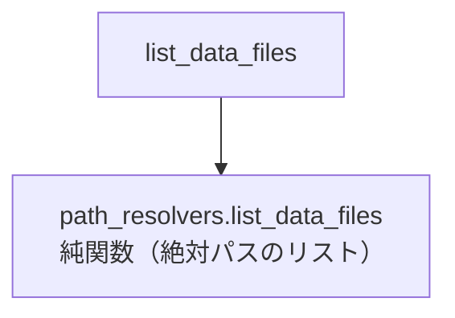

# ワークフロー: データセット投入の入口

データセットを開く入口 `load_dataset` は [mztab.md](mztab.md)（解析フォルダも mzTab-M も同じ入口）。
ここには、その前にフォルダの中身を確かめる `list_data_files` を置く（試料の検索は `dataset_status(view="samples", query=...)`。[mztab.md](mztab.md)）。

## list_data_files

前提: なし
状態変更: なし

ツール層（`tools/dataset.py`）は純関数（`path_resolvers.list_data_files`）の結果を拡張子ごとに
まとめて返す。**`directory` は必須**（既定の探索先・環境変数は無い。B-2b）。
**既定は解析できる拡張子だけ**（.arf / .arf2 / .pai2 / .dcl / .EIC.aef / .mddata /
.mdproject）。MS-DIAL の出力フォルダには測定生データ（.wiff 等）が同居し、実データでは
495 ファイル中 7 割以上がそれだった。全部見たいときだけ `all_files=True`。

`all_files=True` と `extension` 明示のときだけ、**フォルダ形式の計測データ**
（Agilent・Bruker の `.d`、Waters の `.raw`）も一覧に含める。フォルダを一律に
除外すると、その形式だけが入った生データフォルダが「空」に見えて入口で誤読される。
どのフォルダが計測データかの判定は `console/job_manager.py` の `is_raw_input()` が
持ち（上流 `AnalysisFilesParser.ReadFolderContents` の `isVendorDirectory` と同じ規則）、
`path_resolvers` はそれを借りる——同じ規則を 2 か所に書くとドリフトするため。

純関数側は見つからなければ**空リスト**を返す。文面（「存在しません」等）を持つのは
ツール層だけで、以前のようにエラー文字列がパスの位置に紛れ込むことはない。

1. metabolomix/tools/dataset.py  list_data_files()
2. └─ metabolomix/core/path_resolvers.py  list_data_files()
