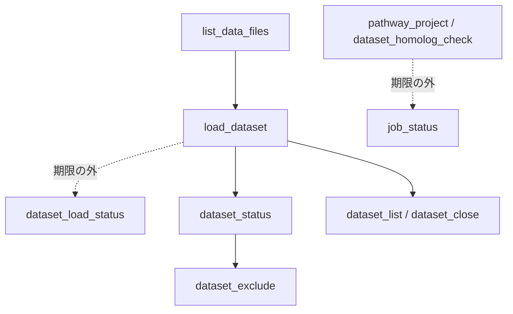

# ワークフロー: データセット投入の入口（読み込み・一覧・閉じる・試料・除外）

値の**意味**（行の粒度・gap-fill・SME と SML・`identification_status`・`name_source`・`inchikey_coverage`）は
`docs/output_format/dataset.md`（解析フォルダ）と `docs/output_format/mztab.md`（mzTab-M）。
入口は `list_data_files` → `load_dataset`（解析フォルダも mzTab-M も同じ入口）。期限（`wait_seconds`）の中で読み終わらなければ
`load_dataset` は受付番号を返し、`dataset_load_status` で結果を引く（こちらも `wait_seconds` で最長 30 秒待てる）。
長い道具（`handle_dispatch.LONG_RUNNING`: `pathway_project` / `dataset_homolog_check`）の受付番号（`job_…`）は `job_status` で引く。
読み込んだデータセットは `dataset_list` / `dataset_close` で管理し、`dataset_status` で試料を確かめ、`dataset_exclude` で外す。

## list_data_files

前提: なし
状態変更: なし
`all_files=True` では raw ごとに見出しを開くので、`handle_dispatch.ALWAYS_THREADED` でワーカースレッドに回す（数百のファイルや
ネットワークの共有で数十秒かかっても、イベントループは `job_status` などに答える）。

ツール層（`tools/dataset.py`）は純関数（`path_resolvers.list_data_files`）の結果を拡張子ごとにまとめて返す。純関数は見つから
なければ空リストを返し、文面はツール層だけが持つ。**`directory` は必須**（既定の探索先・環境変数は無い）。
**既定は解析できる拡張子だけ**（.arf / .arf2 / .pai2 / .dcl / .EIC.aef / .mddata / .mdproject と、MS-DIAL を回した形跡の
`.mzTab`・`analysis-job.json`）。測定生データ（.wiff 等）も見るときは `all_files=True`。
`all_files=True` か `extension` の明示のときだけ、**フォルダ形式の計測データ**（Agilent・Bruker の `.d`、Waters の `.raw`）も
含める。判定は `console/job_manager.py` の `is_raw_input()`（上流 `AnalysisFilesParser.ReadFolderContents` の
`isVendorDirectory` と同じ規則）で、`path_resolvers` はそれを借りる。

`all_files=True` のときは一覧の後に **raw の取得時刻**の節を足す（`metabolomix/rawmeta/`。スペクトルは読まず、ファイルの見出しの
メタデータだけ: `.wiff` の OLE の時刻・mzML の `startTimeStamp`・Thermo `.raw` の見出し・Bruker `.d` の `analysis.tdf` /
`analysis.sqlite`・Agilent `.d` の `AcqData/Contents.xml` の `AcquiredTime`・`.wiff2` は同じ語幹の `.wiff`（SCIEX OS が並べて
書く OLE のファイル。`_read_wiff2`、出所は `wiff_ole_sibling`）。ほかの読めないものは理由を出す）。返すのは:
- raw ごとの取得時刻と順（読めないものは順が空で理由つき）と、40 分を超える間隔の数
- フォルダに `sample-manifest.tsv` があれば、その群（生体試料の行）と取得順の重なり（`complete` / `partial` / `independent` /
  `unknown`）を群の組ごとに。`independent` かは、取得の時刻を間隔で区切ったまとまり（`acquisition_sessions`。群の無い QC も
  間を埋める）ごとに見る（暦の日付では区切らない）。区切る間隔（`session_gap_minutes`）は 40 分と、隣どうしの取得の間隔の
  中央値（`median_low`）の 3 倍の大きいほう。開始が 1 分（`SAME_ACQUISITION_SECONDS`）より近い取得（ベンダーの raw と変換した
  mzML、`.wiff2` と同じ語幹の `.wiff`）は同じ取得として中央値の間隔に数えない。

1. metabolomix/tools/dataset.py  list_data_files()
2. └─ metabolomix/core/path_resolvers.py  list_data_files()
3. └─ metabolomix/tools/dataset.py  _acquisition_lines()
4.    └─ metabolomix/rawmeta/acquisition.py  acquisition_order()
5.       └─ metabolomix/rawmeta/acquisition.py  read_acquisition_times()
6.          └─ [.wiff2] metabolomix/rawmeta/acquisition.py  _read_wiff2()
7.    └─ metabolomix/rawmeta/acquisition.py  gaps_over()
8.    └─ metabolomix/tools/dataset.py  _sheet_groups()
9.    └─ metabolomix/rawmeta/acquisition.py  group_overlap()
10.       └─ metabolomix/rawmeta/acquisition.py  session_gap_minutes()
11.       └─ metabolomix/rawmeta/acquisition.py  acquisition_sessions()

## load_dataset

入口は `metabolomix/dataset/opening.py` の `open_dataset()`。4 つの入口（`directory` / `mztab_path` / `job_path` /
`pipeline_path`）のちょうど 1 つを、`source`（`auto` / `folder` / `mztab`）で決まるアダプタで読む: `directory` は解析フォルダ、
`mztab_path` は mzTab-M、`job_path` / `pipeline_path` は既定で解析フォルダ・`source="mztab"` で mzTab-M。
- 読み込み済みの基はハンドルの登録簿に覚え（キーは入口・アダプタ・measure・allow_incomplete・絶対パス）、読んだファイルと
  探したファイル（`_signature()`: 入力・`source_files`・解析フォルダの付随ファイルと `.arf` / `*_Loaded.*.dbs` の一覧・正準
  mzTab-M と今の `arf_candidates()`・検出状態を取り込んだ `.arf`・ジョブの記録と実効メソッドと MSP と終了証跡・
  `pipeline-run.json`）の size と更新時刻が同じなら読み直さずに複製を返す。
- DatasetState はハンドルに包み（極性・`.arf2` / `.dcl`・データセットが覚えたライブラリ）、`session.adopt_handle()` が登録簿に
  足して**いつも直近にする**（上限なら `DATASET_HANDLE_LIMIT` で止め、直近は動かさない）。
- `analysis_dir`（記録の置き場所の基準: 解析フォルダは選んだ `.arf` のフォルダ、mzTab-M は mzTab-M のフォルダ。指紋には
  入れない）はアダプタが決める。
- `pipeline_path` は `polarity` で run の極性の単位を 1 つ選んでから読む（`session_handoff.resolve_unit()`。単位が 2 つで
  `polarity` を省くと `PIPELINE_POLARITY_REQUIRED` を `needs_input`〔`field=polarity`・`retry_tools=["load_dataset"]`〕にして
  返す。ほかの入口で `polarity` を渡すと `PIPELINE_POLARITY_NOT_APPLICABLE`）。

受付: 引数（`overview`・`library`）を確かめ、`wait_seconds` を 0〜30 秒に丸め（丸めたら `wait_seconds_note`。NaN は
`DATASET_BAD_REQUEST`。MCP からの呼び出しでは型の検査が先に効き、真偽値と数に読める文字列は数に変わって届き、数に読めない値は
引数検査のエラー）、上限の枠を 1 本取ってから（`reserve()`。開いているハンドルと読み込み中の受付の和で数える）、本体
`_load_now()` を受付（`core/pending_loads.py`）の daemon スレッドで始め、受付（`PendingLoad`）を最長 `wait_seconds`（既定 20 秒）
待つ。終われば本体の戻り値を返し、受付は忘れる。終わらなければ受付番号（`ld_…`）を返し、読み込みは続く（デスクトップアプリの
中継は 36〜60 秒ほどで呼び出しを打ち切る）。
- ハンドルの登録と直近の切り替え（`adopt_handle()`）は本体が終わるときに 1 回だけ。受付番号を返した後に別のハンドルが直近に
  なっていたら（`session.current_generation` が進んでいたら）、登録だけして直近にせず、ライブラリも移さず、戻り値に
  `current: false` と `note` を足す。
- 枠は登録で消え、失敗なら返す。本体の例外は受付の誤りの封筒になる（`DomainError` は `mztab_error()`、それ以外は
  `DATASET_LOAD_FAILED`）。
1. metabolomix/tools/handle_tools.py load_dataset()
2. └─ metabolomix/tools/handle_tools.py _argument_error()
3. └─ metabolomix/core/pending_loads.py clamp_wait()
4. └─ metabolomix/core/handles.py HandleRegistry.reserve()（上限なら受け付けない）
5. └─ metabolomix/core/pending_loads.py PendingCalls.submit()（`_load_reserved()` を daemon スレッドで回す。`tool` と入力の名前 `_input_label()` を添える。`announced=False`: 受付番号を返すまで、省いた `dataset_load_status` の候補に並べない）
6.    └─ metabolomix/core/pending_loads.py PendingCalls._run()
7.       └─ metabolomix/tools/handle_tools.py _load_reserved()（本体。中身は下の入口とアダプタの選び方。終われば枠を返す）
8. └─ metabolomix/core/pending_loads.py PendingLoad.wait()
9. └─ [期限の中で終わったとき] metabolomix/core/pending_loads.py PendingCalls.discard()
10. └─ [期限の中で終わったとき] metabolomix/core/pending_loads.py with_wait_note()
11. └─ [終わらなかったとき] metabolomix/tools/handle_tools.py _CurrentTicket.detach()
12. └─ [終わらなかったとき] metabolomix/core/pending_loads.py PendingCalls.announce()（受付番号を返す。ここから省いた問い合わせの候補に並ぶ）

入口とアダプタの選び方（本体。受付のスレッドで回る）:
1. metabolomix/tools/handle_tools.py _load_now()
2. └─ metabolomix/core/handles.py HandleRegistry.check_capacity()
3. └─ metabolomix/dataset/opening.py open_dataset()
4.    └─ metabolomix/core/handles.py HandleRegistry.cached_base()
5.    └─ metabolomix/dataset/opening.py _open()
6.       └─ [pipeline_path] metabolomix/pipeline/session_handoff.py resolve_unit()（極性の単位を選ぶ。中身は下の pipeline_path 経路）
7.       └─ [mzTab-M のアダプタ] metabolomix/dataset/opening.py _load()（下の 3 経路）
8.       └─ [directory] metabolomix/dataset/alignment_files.py select_alignment()
9.       └─ [directory] metabolomix/dataset/msdial_adapter.py load_msdial_folder()
10.         └─ metabolomix/dataset/msdial_adapter.py _console_default_classes()（Console の既定の `.mddata` なら群を置かず役割をファイル名から推定）
11.      └─ [directory] metabolomix/dataset/opening.py _fill_formula_theoretical_mz()（mzTab-M と照合しないので、SME rank 1 の理論 m/z を注釈の組成式と付加体から計算。`theoretical_mz_source = formula_adduct`）
12.         └─ metabolomix/analysis/feature_search.py theoretical_mz()
13.      └─ [directory] metabolomix/dataset/opening.py _enclosing_run_unit()（上へ 3 段まで `pipeline-run.json` を探し、解析フォルダがこのフォルダの単位を選ぶ）
14.         └─ metabolomix/pipeline/session_handoff.py resolve_unit()
15.      └─ [run の中の directory] metabolomix/dataset/opening.py _apply_run_rows()（試料を raw の名前か sample_id で結び、run の試料の対応表を当てる）
16.         └─ metabolomix/analysis/sample_manifest.py resolve_metadata()
17.         └─ metabolomix/analysis/sample_manifest.py apply_defaults_and_inputs()
18.      └─ [job_path を解析フォルダで] metabolomix/dataset/opening.py _folder_via_job()
19.         └─ metabolomix/mztab/loading.py job_gate()
20.         └─ metabolomix/mztab/loading.py job_artifact_paths()
21.         └─ metabolomix/dataset/opening.py _matching_arf()
22.            └─ metabolomix/mztab/evidence.py first_matching_arfs()（pipeline の validate_outputs と共有する選び方）
23.               └─ metabolomix/mztab/evidence.py arf_candidates()
24.            └─ metabolomix/mztab/loading.py read_mztab()
25.            └─ metabolomix/mztab/evidence.py join_axes()
26.            └─ metabolomix/mztab/evidence.py matching_arfs()
27.               └─ metabolomix/mztab/evidence.py scan_arf()（最初に通った候補の ArfScan を返す）
28.            └─ [pipeline で候補が合わないとき、単位の解析フォルダのバッチを新しい順に] metabolomix/dataset/alignment_files.py arf2_batches_newest_first()
29.         └─ metabolomix/dataset/alignment_files.py select_alignment()
30.         └─ metabolomix/dataset/msdial_adapter.py load_msdial_folder()（照合に読んだ ArfScan を使い、`.arf` を読み直さない）
31.         └─ metabolomix/dataset/opening.py _fill_theoretical_mz()（照合した mzTab-M の SME rank 1 の理論 m/z を同じスポット ID に写す。`theoretical_mz_source = mztab`）
32.      └─ [pipeline_path を解析フォルダで] metabolomix/dataset/opening.py _folder_via_run()
33.         └─ metabolomix/dataset/opening.py _folder_via_job()（単位のジョブで。照合の候補に単位の解析フォルダ `analysis_dir` を渡す）
34.         └─ [単位が試料の対応表を持つとき] metabolomix/pipeline/session_handoff.py bind_manifest_rows()（mzTab-M のアダプタと同じ。中身は下の pipeline_path 経路の 9〜13）
35.      └─ [directory] metabolomix/dataset/library_memory.py remember_from_folder()
36.      └─ [run の中の directory] metabolomix/dataset/library_memory.py remember_from_run()（known / lbm_only ならこちら）
37.      └─ [job_path] metabolomix/dataset/library_memory.py remember_from_job()
38.      └─ [pipeline_path] metabolomix/dataset/library_memory.py remember_from_run()（選んだ極性の単位の入力から）
39.      └─ [mztab_path] metabolomix/dataset/library_memory.py unknown_record()
40.   └─ metabolomix/dataset/opening.py _signature()
41.   └─ metabolomix/core/handles.py HandleRegistry.put_base()
42. └─ metabolomix/mztab/polarity.py dataset_polarity()
43. └─ metabolomix/tools/handle_tools.py alignment_files_for()
44. └─ metabolomix/tools/handle_tools.py _recall_assay_kind()（解析フォルダの目的ファイルの `assay_kind` をハンドルへ読み戻す）
45.   └─ metabolomix/core/mcp_core.py _report_dir_candidates()
46.   └─ metabolomix/tools/objective.py recall_assay_kind()
47. └─ metabolomix/tools/handle_tools.py _open_library_for()
48. └─ metabolomix/core/session_state.py AnalysisSession.adopt_handle()（直近にする。受け付けた読み込みは `_CurrentTicket.may_become_current()` に従う。直近のハンドルが無いうちに記録したセッションの種別は `_SessionKindCarry` がこのハンドルへ移す）
49.    └─ metabolomix/core/handles.py HandleRegistry.add()
50. └─ [開く前に記録した種別を引き継いだとき] metabolomix/tools/handle_tools.py _SessionKindCarry.persist()（登録の後。ハンドルのロックを最長 `HANDLE_LOCK_WAIT` 待ち、その種別を書いた目的にこの解析フォルダを書く。書けなければ `notes` に記録し直すよう書く）
51.    └─ metabolomix/tools/objective.py persist_carried_kind()
52. └─ metabolomix/tools/mztab_tools.py load_summary_lines()
53.    └─ [解析フォルダ] metabolomix/tools/mztab_tools.py _folder_summary_text()
54.    └─ [mzTab-M] metabolomix/tools/mztab_tools.py _summary_text()
55. └─ metabolomix/tools/mztab_tools.py sample_group_role_counts()
56. └─ metabolomix/dataset/library_memory.py public_view()
57. └─ metabolomix/core/session_state.py AnalysisSession.take_caveat()（意味論の要約。このハンドルの種別で、未読・種別ごとに 1 回だけ。戻り値の最上位 `caveat`）
58. └─ [overview=True] metabolomix/tools/handle_tools.py _first_overview()（既定は計算しない。`dataset_overview` と同じ組み立て）

job / pipeline を解析フォルダで読むときも、ジョブの門（`job_gate()`: ジョブの記録・完了・正準 mzTab-M の一意な選択と実在・
出所の裏取り）は mzTab-M で読むときと同じで、`exploratory_only`・`source_verification`・`job_path` を同じ規則で書く。
- `.arf` は正準 mzTab-M の evidence と同じ候補（`arf_candidates()`。pipeline はどれも合わなければ単位の解析フォルダ
  `<極性>/input/` のバッチを新しい順に 1 本ずつ。`first_matching_arfs()`）のうち、検出状態の取り込みと同じ検証
  （`matching_arfs()` → `scan_arf()` → `scan_evidence()`。`build_evidence()` と判定を共有。特徴数・m/z・試料名）を通った
  ちょうど 1 本。照合に読んだ `ArfScan` を `load_msdial_folder()` に渡し、`.arf` を 2 度読まない。
- 通るものが無ければ `ALIGNMENT_NOT_FOUND`、2 本以上なら `ALIGNMENT_AMBIGUOUS`（どちらも候補のファイル名を
  `details.candidates` に載せて `source="mztab"` を示し、mzTab-M へ黙って切り替えない。`ALIGNMENT_AMBIGUOUS` は完了した
  ジョブでだけ「ジョブの検査を通らない」注意つきで `directory` も示す）。ジョブの mzTab-M が壊れていれば code はそのまま
  （`MZTAB_STRUCTURE_INVALID`）で、`directory` で開く道を示す。
- ジョブが記録した付随アーティファクト（`job_artifact_paths()`）は `artifact_paths` に載せる。
- pipeline の run から引き継ぐのは試料の対応表だけ（v3 の run は受領 `results/receipt.json` の `units.<極性>.samples.rows`、
  旧 v1 の run は記録の `inputs.manifest`）。当て方は下の pipeline_path 経路の後の段落（`bind_manifest_rows()`）。受領が無い・
  照合できない v3 の run は run の記録の単位から解析フォルダを引き、試料の対応表は載らない（注記が出る）。
- 検証を通っていない単位（`validated` でない）は `PIPELINE_UNIT_NOT_VALIDATED` で止め、`allow_incomplete=True` なら探索用に
  読む。旧 v1 の run が計算した差次的結果はどちらの経路でも載せない（注記が出る。比較は `dataset_compare` でやり直す）。

mztab_path 経路（直接指定）:
1. metabolomix/dataset/opening.py _load()
2. └─ metabolomix/mztab/loading.py load_dataset_state()
3.    └─ metabolomix/mztab/loading.py read_mztab()
4.       └─ metabolomix/mztab/reader.py parse_mztab()
5.       └─ metabolomix/mztab/validator.py validate_mztab()
6.       └─ metabolomix/mztab/dataset_state.py build_dataset_state()
7.          └─ metabolomix/mztab/validator.py detect_quantification_measure()
8.          └─ metabolomix/mztab/reader.py extract_abundance_matrix()
9.          └─ metabolomix/mztab/dataset_state.py _index_sme_rows()
10.         └─ metabolomix/mztab/dataset_state.py _best_evidence()
11.         └─ metabolomix/mztab/dataset_state.py _resolve_inchikey()（MSP 表なし。中で derive_inchikey）
12.         └─ metabolomix/mztab/dataset_state.py _build_feature_annotations()
13.            └─ metabolomix/mztab/dataset_state.py _resolve_inchikey()
14.         └─ metabolomix/mztab/dataset_state.py _resolve_sample_names()
15.   └─ metabolomix/mztab/evidence.py attach_to_dataset()
16.      └─ metabolomix/mztab/evidence.py join_axes()
17.      └─ metabolomix/mztab/evidence.py arf_candidates()
18.      └─ metabolomix/mztab/evidence.py load_arf_evidence()
19.         └─ metabolomix/mztab/evidence.py scan_arf()（`.arf` を 1 回、metabolomix/arf/reader.py iter_groups() でストリーミングに読む）
20.         └─ metabolomix/mztab/evidence.py scan_evidence()
21.         └─ metabolomix/mztab/evidence.py _join()（build_evidence() と共有の判定）
22.      └─ metabolomix/mztab/evidence.py apply_evidence()

job_path 経路（`source="mztab"`。analysis-job.json の宣言 polarity + measure で正準を選ぶ）:
1. metabolomix/dataset/opening.py _load()
2. └─ metabolomix/mztab/loading.py load_dataset_state()
3.    └─ metabolomix/mztab/loading.py job_gate()
4.       └─ metabolomix/handoff/schema.py AnalysisJob.load()
5.       └─ metabolomix/mztab/loading.py select_primary_entry()
6.       └─ metabolomix/mztab/loading.py _verify_source()
7.    └─ metabolomix/mztab/reader.py parse_mztab()
8.    └─ metabolomix/mztab/validator.py validate_mztab()
9.    └─ metabolomix/mztab/loading.py _msp_table_for_job()
10.      └─ metabolomix/console/method_file.py read_method_keys()
11.      └─ metabolomix/mztab/msp_inchikey.py load_msp_inchikey_table()
12.   └─ metabolomix/mztab/validator.py detect_quantification_measure()
13.   └─ metabolomix/mztab/dataset_state.py build_dataset_state()
14.      └─ metabolomix/mztab/reader.py extract_abundance_matrix()
15.      └─ metabolomix/mztab/dataset_state.py _index_sme_rows()
16.      └─ metabolomix/mztab/dataset_state.py _best_evidence()
17.      └─ metabolomix/mztab/dataset_state.py _resolve_inchikey()
18.         └─ metabolomix/mztab/msp_inchikey.py lookup()
19.         └─ metabolomix/mztab/identity.py derive_inchikey()
20.      └─ metabolomix/mztab/dataset_state.py _build_feature_annotations()
21.         └─ metabolomix/mztab/dataset_state.py _resolve_inchikey()
22.      └─ metabolomix/mztab/dataset_state.py _resolve_sample_names()
23.   └─ metabolomix/mztab/loading.py job_artifact_paths()
24. └─ metabolomix/mztab/evidence.py attach_to_dataset()

pipeline_path 経路（`source="mztab"`。選んだ極性の単位のジョブの正準 mzTab-M を読む）:
1. metabolomix/dataset/opening.py _load()
2. └─ metabolomix/pipeline/session_handoff.py load_run_dataset()
3.    └─ metabolomix/pipeline/session_handoff.py resolve_unit()
4.       └─ metabolomix/pipeline/recovery.py normalize_pipeline_root()
5.       └─ metabolomix/pipeline/store.py load_run()
6.       └─ [v3 の run] metabolomix/pipeline/receipt.py read_receipt()
7.       └─ [旧 v1 の run] metabolomix/pipeline/session_handoff.py run_manifest_rows()
8.    └─ metabolomix/mztab/loading.py load_dataset_state()
9.    └─ metabolomix/pipeline/session_handoff.py bind_manifest_rows()（結べなければ注記を `ds.load_notes` へ）
10.      └─ metabolomix/pipeline/session_handoff.py _bind_manifest_rows()
11.         └─ metabolomix/analysis/sample_manifest.py resolve_metadata()
12.         └─ [raw のパスで結べないとき] metabolomix/pipeline/session_handoff.py _rows_by_name()
13.         └─ metabolomix/analysis/sample_manifest.py apply_defaults_and_inputs()

dataset と試料の対応表は**同じ run の同じ単位から**載せる。対応表の行は**試料へ結んでから**当てる（`bind_manifest_rows()`。
受領の行の並びはシートの並び〔`pipeline_sample_sheet` なら取得順〕で、mzTab-M の assay の順とは限らない）。
- まず raw のパス（mzTab-M の `ms_run[N]-location` → `ds.assay_sources`）で、結べなければ行の raw の名前か `sample_id` で
  試料名と結ぶ（`directory` で run の中の解析フォルダを開く `opening._apply_run_rows` と同じ鍵）。
- 名前で結んだときは行の raw のパス（今の run の場所）を `ds.sample_raw_paths` に残し、あとの `dataset_set_sample_metadata` は
  シートの置き場所と試料への結び方をこの値から取る（`ds.assay_sources` は Console が走ったときの場所のまま）。
- 全試料を結べなければ読み込みは止めずに当てず、`load_notes` に注記を残す（解析フォルダのアダプタ `_folder_via_run()` も
  同じ）。`load_notes` は `load_dataset` の `summary` の「読み込みの注記」の行（`_summary_text()` / `_folder_summary_text()`）と
  `dataset_status` の `load_notes` に出る。

`resolve_unit()` は `pipeline-run.json` の版で分かれる: v3 の run は受領（`read_receipt()`。登録した hash と照合してから読む）の
単位から解析フォルダ・ジョブ・試料の対応表を引き、旧 v1 の run（`store.is_legacy()`。読むだけの記録）は 1 単位として、
`resolve_metadata` が `record["inputs"]["manifest"]` に書いた行（`run_manifest_rows()`）を引く。run が計算した差次的結果は戻さない
（比較は `dataset_preprocess` → `dataset_compare` でやり直す）。

`source_verification` は終了証跡（exit code・identity）とファイル hash が揃って `verified`、ジョブ経由でも証跡が無ければ
`legacy_unverified`、直接読みは `direct_unverified`。`status == "completed"` の文字列は根拠にしない。

完了していない実行（partial / failed / running）の出力は既定で読まない（`INCOMPLETE_ANALYSIS_JOB`）。`allow_incomplete=True` で
読むと `exploratory_only=True`（理由は `exploratory_reason`。`JobGate.exploratory_reason`）。同じ印は、`pipeline_path` で検証を
通っていない単位を開いたとき（ジョブの status によらない。`opening._mark_unvalidated_unit`、`store.unit_status` が `validated`
でない）と、`directory` で run の中の解析フォルダを開き `_enclosing_run_unit()` が引いた単位が検証を通っていないとき（読み込みは
断らず、理由に run のフォルダ名を足す。試料の対応表とライブラリもその単位から当てる）にも付く。比較も書き出しも断らず、差次的 TSV のメタ行・根拠バンドルの manifest・図の但し書き・
`dataset_overview` の比較を使う段の先頭の事実に印を載せる（`docs/output_format/dataset.md` の 11.4・11.9）。

`select_primary_entry()` は候補が一意に決まらなければ読まずに止める（`QUANTIFICATION_CONFLICT` / `POLARITY_MISMATCH` /
`AMBIGUOUS_PRIMARY_MZTAB`）。辞書順では選ばない。

job_path 経路では手順 24（`attach_to_dataset`）が `artifact_paths` を入れた**後**に来る。handoff が記録した
`peak_matrix_source` を `.arf` 候補の先頭に使えるのはその後だけ。

### evidence sidecar（検出状態）の取り込み

mzTab-M の `abundance_assay[N]` は実測と gap-fill を区別しないので（意味は `docs/output_format/mztab.md` の 13.7）、隣接する
`.arf`（(スポット × サンプル) の粒度で `MasterPeakID < 0` = gap-fill）から検出状態を補う。接合は**名前ではなく数値で検証する**:
`.arf` のスポット順が mzTab の `SMF_ID` と一致することを、スポット数の一致と全特徴の m/z 差（既定 0.01 Da 以内）で確かめる。
確かめられなければ取り込まず、`feature_qc` に理由を残して warning を出す。

結果は `ds.detected_mask`（(特徴 × サンプル) の bool 行列）・`ds.feature_qc`（要約）・試料ごとのピークの RT `ds.per_sample_rt`
（`_join()` が `.arf` の列を mzTab-M の試料の順に並べ替える。`dataset_sample_peaks` の材料）。TSV は書かない。

## dataset_status

`view` で 4 通り（各 view の欄は `docs/output_format/mztab.md` の 13.5b）。`summary`（既定）は概要に群・役割・タグ・除外の件数と
ハンドルの `assay_kind` を足し、`samples` は試料の TSV（`query` の因子トークンは `metabolomix/msdial/sample_factors.py` が照合する）、
`tags` はタグごとの特徴 ID、`results` はハンドルの統計の行列（`ds.stat_matrices`）と結果（`ds.results`）の一覧。`query` は
`samples` と `tags` でだけ効き、`summary` / `results` では使わず `notes` に書く（断らない）。

`summary`:
1. metabolomix/tools/mztab_tools.py dataset_status()
2. └─ metabolomix/tools/mztab_tools.py _samples_tsv()（役割は試料の表から）
3.    └─ metabolomix/tools/mztab_tools.py _metadata_rows()
4. └─ metabolomix/tools/mztab_tools.py _detection_summary()
5. └─ metabolomix/tools/mztab_tools.py sample_group_role_counts()
6.    └─ metabolomix/tools/mztab_tools.py _metadata_rows()
7. └─ metabolomix/tools/mztab_tools.py _tag_counts()

`samples`:
1. metabolomix/tools/mztab_tools.py dataset_status()
2. └─ metabolomix/tools/mztab_tools.py _samples_view()
3.    └─ metabolomix/tools/mztab_tools.py _metadata_rows()
4.    └─ metabolomix/msdial/sample_factors.py build_sample_facets()
5.    └─ metabolomix/msdial/sample_factors.py expand_sample_specs()
6.    └─ metabolomix/msdial/sample_factors.py token_vocabulary()

`tags`:
1. metabolomix/tools/mztab_tools.py dataset_status()
2. └─ metabolomix/tools/mztab_tools.py _tags_view()

`results`（`current` の決め方は 13.5b）:
1. metabolomix/tools/mztab_tools.py dataset_status()
2. └─ metabolomix/tools/mztab_tools.py _results_view()
3.    └─ metabolomix/analysis/result_state.py dataset_fingerprint()
4.    └─ metabolomix/tools/mztab_tools.py _matrix_recipe()
5.    └─ metabolomix/analysis/result_state.py is_stats_current()（来歴に指紋を持つ結果）
6.    └─ metabolomix/analysis/result_state.py is_current()（それ以外）
7.    └─ metabolomix/analysis/stats_results.py contrast_ids()

## dataset_exclude

試料・特徴を解析から外す（可逆。意味は `docs/output_format/mztab.md` の 13.5b）。状態は `DatasetState.excluded_samples` /
`excluded_features`（名前・特徴 ID -> 理由）。入力の指紋には入れず、変わったときだけ `metadata_revision` を進めて前処理済み行列
から先の結果を古くし（`apply_metadata` と同じ `invalidate_results`）、統計エンジンの行列（`ds.stat_matrices`）も空にする（除外の
前の行列 ID は使えなくなる）。除外を当てるのは統計エンジンの `dataset_preprocess`（`study_inputs` が入力へ写す）。

1. metabolomix/tools/sample_tools.py dataset_exclude()
2. └─ metabolomix/analysis/dataset_exclusions.py apply_exclusions()
3.    └─ metabolomix/analysis/dataset_exclusions.py _resolve_samples()
4.    └─ metabolomix/analysis/dataset_exclusions.py _resolve_features()
5.    └─ metabolomix/analysis/result_state.py invalidate_results()

除外の適用（`dataset_preprocess` の中。`study_inputs` が `ds.excluded_*` を `from_dataset` の入力へ写す）:
1. metabolomix/tools/stats_tools.py dataset_preprocess()
2. └─ metabolomix/analysis/stats_results.py study_inputs()
3. └─ metabolomix/analysis/stats/data.py from_dataset()

## dataset_load_status

前提: `load_dataset` が受付番号（`ld_…`）を返していること（知らない番号は `DATASET_LOAD_NOT_FOUND`）。`load_id` を省くと、
受付番号を渡し済み（`announce()` 済み）でまだ結果を渡していない受付（`PendingCalls.unclaimed()`。まだ自分の `wait_seconds` の中で
待っている `load_dataset` の受付は並べない）から選ぶ: 1 本ならそれ、2 本以上なら `needs_input`（`field=load_id`・選択肢は受付の
一覧・`retry_tools=["dataset_load_status"]`）、無ければ `missing_state("load", ["load_dataset"])`。
状態変更: なし（ハンドルの登録と直近の切り替えは受付のスレッドが済ませる）。結果を渡した受付には印を付け
（`PendingCalls.claim()`）、省いた呼び出しの候補から外す。
- 読み込み中は `{"status": "loading", "load_id", "elapsed_s"}`、終われば `load_dataset` の戻り値そのもの。
- 終わった受付は 1 時間覚え（番号を渡せば同じ文字列を返す）、64 件を超えると終わったものを古い順に捨てる。読み込み中のものは
  捨てず、64 件すべてが読み込み中なら `load_dataset` が `DATASET_LOAD_LIMIT` で受け付けない。
- `wait_seconds`（既定 0。`clamp_wait()` が 0〜30 秒に丸める。`wait_seconds_note`・NaN・型の検査は `load_dataset` と同じ）が
  0 より大きければ最長その秒数だけ待ち、その中で終われば戻り値を、終わらなければ今の状態を返す。

1. metabolomix/tools/handle_tools.py  dataset_load_status()
2. └─ metabolomix/tools/handle_tools.py  _pick_pending()
3.    └─ [load_id を省いたとき] metabolomix/core/pending_loads.py  PendingCalls.unclaimed()
4. └─ metabolomix/tools/handle_tools.py  _poll()
5.    └─ metabolomix/core/pending_loads.py  clamp_wait()
6.    ├─ [wait_seconds > 0] metabolomix/core/pending_loads.py  PendingCalls.wait()
7.    │  ├─ metabolomix/core/pending_loads.py  PendingCalls._lookup()
8.    │  └─ metabolomix/core/pending_loads.py  PendingLoad.wait()
9.    └─ metabolomix/core/pending_loads.py  PendingCalls.snapshot()
10.      ├─ metabolomix/core/pending_loads.py  PendingCalls._prune()
11.      └─ metabolomix/core/pending_loads.py  PendingCalls._lookup()
12.   └─ [終わっていたとき] metabolomix/core/pending_loads.py  PendingCalls.claim()

## job_status

長い道具（`handle_dispatch.LONG_RUNNING`: `pathway_project` / `dataset_homolog_check`。どれも `wait_seconds`、既定 20 秒）は
`install()` が `_wrap_job()` で包む。呼び出しは受付（`pending_loads.jobs`、`PendingJobs`）の daemon スレッドで始まり、ハンドルの
ロックと固定はそのスレッドが仕事の終わりまで持つ（`_job_call()`: `dataset_handle` を渡せば `_call_locked()`、省けば受け付けた
ときの直近のハンドルで `_call_pinned()`）。仕事のスレッドはロックが空くまで待ち（`_acquire(job=True)`。`HANDLE_LOCK_WAIT` を
使わない）、持つ間は `DatasetHandle.running_job` に受付番号と道具を置く（ほかの呼び出しの `HANDLE_BUSY` と `queued_behind()` が
読む）。`wait_seconds` の中で終われば戻り値を返し（受付は忘れる）、終わらなければ受付番号を渡した印を付けて
（`PendingCalls.announce()`）`{"status": "running", "job_id": "job_…", "tool", "dataset_handle", "next"}`（順番待ちなら
`queued_behind`）を返し、仕事は続く。
前提: その受付番号を道具が返していること（知らない番号は `JOB_NOT_FOUND`）。`job_id` を省くと、受付番号を渡し済みでまだ結果を
渡していない受付（`PendingCalls.unclaimed()`）から選ぶ: 1 本で、それが直近のハンドル（`session.current_handle_id`）かハンドル
なしの仕事ならそれ、直近でないハンドルの仕事 1 本や 2 本以上なら `needs_input`（`field=job_id`・label にハンドル・
`retry_tools=["job_status"]`）、無ければ `missing_state("job", ["pathway_project", "dataset_homolog_check"])`。
状態変更: なし。走っている間は `{"status": "running", "job_id", "tool", "dataset_handle", "elapsed_s"}`（順番待ちなら
`queued_behind`）、終われば道具の戻り値（JSON のオブジェクトなら先頭に `job_id` と `dataset_handle` を足す。`with_fields()`）。
仕事が例外で終われば `JOB_FAILED` の封筒。

同じハンドルへのほかの呼び出し（`_call_locked()` / `_call_pinned()`）は、ロックを最長 `HANDLE_LOCK_WAIT`（25 秒）待つ
（`_acquire()`）。空かなければツールを呼ばずに `mcp_errors.handle_busy()` の `HANDLE_BUSY`（ロックを持つ仕事があれば
`details.job_id` / `tool` / `running_s` / `next` と `required_tools=["job_status"]`）を返す。

受付（長い道具の呼び出し）:
1. metabolomix/core/handle_dispatch.py  _wrap_job()
2. └─ metabolomix/core/pending_loads.py  clamp_wait()
3. └─ metabolomix/core/handle_dispatch.py  _job_call()
4. └─ metabolomix/core/pending_loads.py  PendingCalls.submit()（`announced=False`）
5.    └─ [受付のスレッド] metabolomix/core/handle_dispatch.py  _acquire()（`job=True`。`running_job` を置く）
6. └─ metabolomix/core/pending_loads.py  PendingLoad.wait()
7. └─ [終わらなかったとき] metabolomix/core/pending_loads.py  PendingCalls.announce()
8. └─ [終わらなかったとき] metabolomix/core/handle_dispatch.py  queued_behind()

引く:
1. metabolomix/tools/handle_tools.py  job_status()
2. └─ metabolomix/tools/handle_tools.py  _pick_pending()
3. └─ metabolomix/core/pending_loads.py  PendingCalls.tool_of()
4. └─ metabolomix/core/pending_loads.py  PendingCalls.label_of()
5. └─ metabolomix/tools/handle_tools.py  _poll()
6.    ├─ [走っているとき] metabolomix/core/handle_dispatch.py  queued_behind()
7.    └─ [終わっていたとき] metabolomix/core/pending_loads.py  with_fields()

ハンドルが塞がっているとき（長い道具でないツールの呼び出し）:
1. metabolomix/core/handle_dispatch.py  _call_locked()（`_call_pinned()` も同じ）
2. └─ metabolomix/core/handle_dispatch.py  _acquire()
3.    └─ [`HANDLE_LOCK_WAIT` 秒で取れなかったとき] metabolomix/core/handle_dispatch.py  _busy()
4.       └─ metabolomix/core/mcp_errors.py  handle_busy()

## dataset_list

前提: なし。状態変更: なし。`current` は `session.current_handle_id` と同じハンドルか。`assay_kind` は
そのハンドルのデータセットの種別（`DatasetHandle.assay_kind`）。

1. metabolomix/tools/handle_tools.py  dataset_list()
2. └─ metabolomix/core/handles.py  HandleRegistry.list()

## dataset_close

前提: そのハンドルが開いていること（無ければ `DATASET_HANDLE_NOT_FOUND`）。
状態変更: 登録簿から外し、ライブラリの接続を閉じる（そのハンドルのライブラリはハンドルと一緒に無くなる。`session.library` が
直近のハンドルのライブラリならこれも無くなる）。直近のハンドルなら、セッションはデータセットが無い状態になる（次に
`session.dataset` を読んだときに `current_handle_id` を None に戻す。別のハンドルへは落ちない）。

戻り値の `source`（入口の種類・入力の名前・極性）は閉じる前に `HandleRegistry.peek()` で読む。閉じるのもそのハンドルのロックの下
（`handle_dispatch._call_locked()`）で、長い道具の仕事がロックを持っていれば `HANDLE_BUSY`（job_status の節。仕事は止めない）。

1. metabolomix/tools/handle_tools.py  dataset_close()
2. └─ metabolomix/core/handles.py  HandleRegistry.peek()
3. └─ metabolomix/core/handles.py  HandleRegistry.close()
4.    └─ metabolomix/core/handles.py  DatasetHandle.close()
